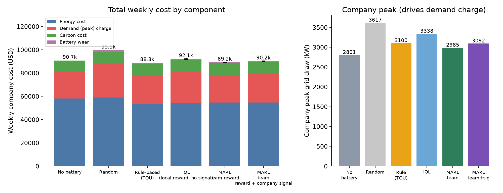
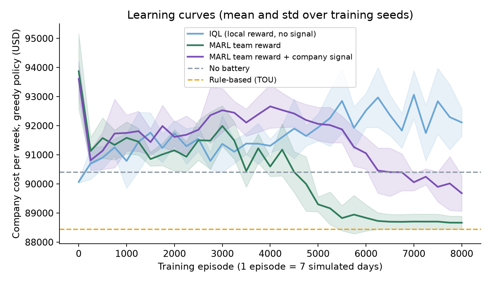
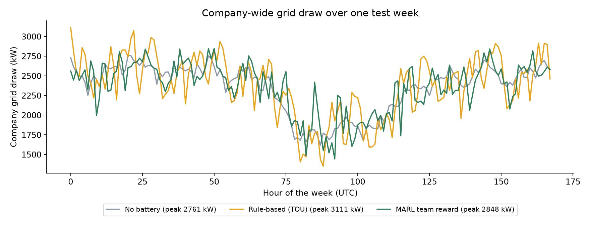
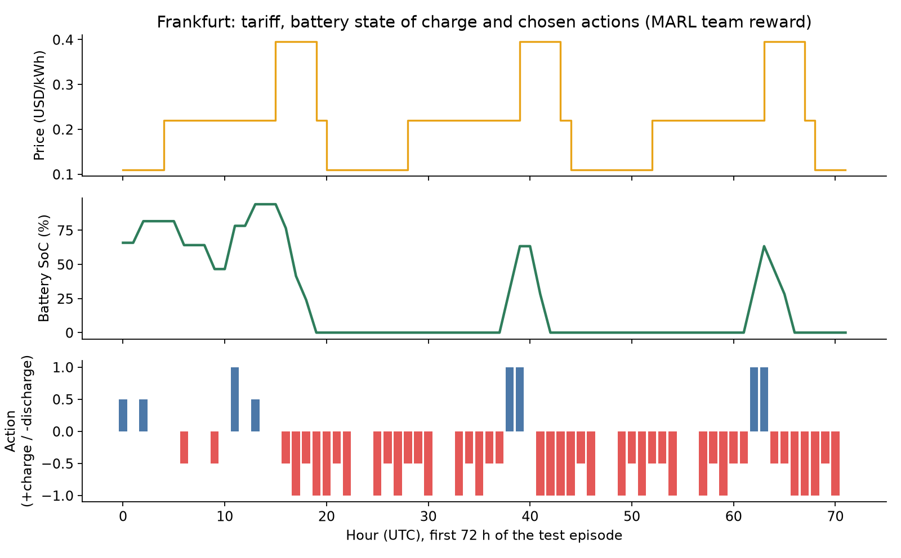
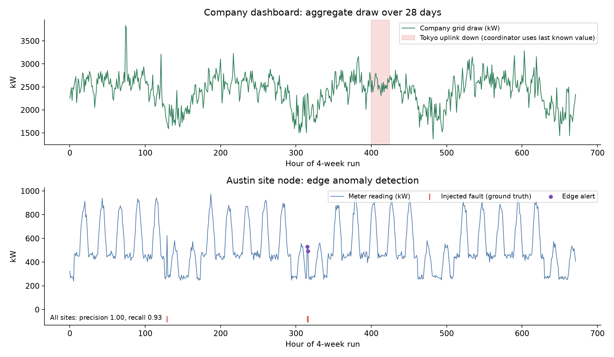

# Distributed Energy Monitoring and Control for a Multi-National Company using Multi-Agent Reinforcement Learning

A distributed system that monitors electricity use at the sites of a multi-national company and
controls each site's battery with a learned policy. Every site is an independent process (a **site
node**) with its own meter stream, edge anomaly detector and reinforcement-learning agent. A central
**coordinator** aggregates the company-wide load, handles node failures and broadcasts a company-load
signal back to the sites.

> **All data is synthetic.** Site sizes, tariffs, carbon intensities, solar profiles, battery sizes and
> the demand charge are our own assumptions (`energy/config.py`). No real company data is used, and the
> cost figures are simulation results, not predictions for a real company.

## 1. What the system does

| Layer | What it does | Where |
|---|---|---|
| Data generator | Hourly load, solar output and injected faults for 6 sites in 6 countries (time zones, weekday/weekend, cloud cover) | `energy/simulator.py` |
| Site node (one process per site) | Runs the site's battery + grid physics, its trained agent and an edge anomaly detector | `energy/distributed.py` |
| Coordinator | Aggregates readings, tracks site health, back-fills data after outages, broadcasts the company-load signal | `energy/distributed.py` |
| Multi-agent RL | One Q-learning agent per site chooses a battery action every hour | `energy/agents.py`, `scripts/train.py` |
| Monitoring | Rolling per-hour baseline detector flags load spikes and dead meters | `energy/detector.py` |

```
                        company-load signal (low / medium / high)
         +----------------------------------------------------------+
         |                                                          v
   +-------------+   report(t): meter readings, SoC, cost, alert  +-----------+
   | Site node 1 | -------------------------------------------->  |           |
   | Site node 2 | -------------------------------------------->  |Coordinator|---> monitoring log,
   |    ...      |        (one OS process per site,               | aggregate |     alerts, events,
   | Site node 6 | -------------------------------------------->  | + health  |     company dashboard
   +-------------+        message queues)                          +-----------+
     each node: SiteSim (battery, solar, tariff) + trained Q-agent + edge anomaly detector
```

### The sites (synthetic)

| Site | Country | UTC offset | Profile | Peak demand | PV | Battery |
|---|---|---|---|---|---|---|
| Mumbai | India | +5 | factory | 800 kW | 500 kW | 960 kWh / 320 kW |
| Frankfurt | Germany | +1 | office | 600 kW | 250 kW | 720 kWh / 240 kW |
| Austin | USA | -6 | office | 900 kW | 600 kW | 1080 kWh / 360 kW |
| Sao Paulo | Brazil | -3 | factory | 500 kW | 350 kW | 600 kWh / 200 kW |
| Tokyo | Japan | +9 | office | 700 kW | 300 kW | 840 kWh / 280 kW |
| Johannesburg | South Africa | +2 | factory | 450 kW | 300 kW | 540 kWh / 180 kW |

Because the sites are in different time zones, their local peaks fall at different UTC hours. The
company is billed a **demand charge on its combined peak** (USD 8 per kW per week), so sites that each
optimise only their own bill can still raise the company peak. That is the coordination problem the
multi-agent part addresses.

## 2. The multi-agent RL problem

* **Agents:** one per site (6), decentralised execution.
* **Action (5):** battery idle, charge 100 %, charge 50 %, discharge 50 %, discharge 100 %.
* **Observation (per agent):** local hour (24) x battery state of charge (5 buckets) x local net load
  `(load - solar) / peak` (3 buckets). Variant `team_signal` adds the coordinator's company-load level
  (3 levels), the only information that crosses site boundaries.
* **Dynamics:** battery round-trip efficiency about 90 %, no export of surplus solar, time-of-use tariff
  by local hour (off-peak 0.5x, mid 1.0x, peak 1.8x), per-country carbon intensity.
* **Company objective (reported metric):** energy cost + demand charge on the company peak + carbon cost
  (USD 0.05 per kg CO2) + battery wear (USD 0.01 per kWh stored).
* **Learning:** tabular Q-learning, 8000 training episodes of 7 simulated days, 5 random seeds per variant.

Three variants form an ablation:

| Variant | Reward each agent receives | Communication |
|---|---|---|
| `iql` | its own saving only | none |
| `team` | own saving plus a shared penalty when the company draw exceeds 92 % of the unmanaged peak | none |
| `team_signal` | same as `team` | company-load level broadcast by the coordinator |

Two training aids are used and are part of the method (`energy/simulator.py`): rewards are measured
relative to an *idle-battery baseline* (it depends only on load, solar and price, so it does not change
which policy is best but removes most noise), and the demand-charge is shaped as a per-hour penalty above
a reference level, because the true charge depends only on one hour per week and gives almost no
learning signal. Evaluation always uses the **true** company cost, never the shaped reward.

Baselines: **No battery**, **Random**, and **Rule-based (TOU)** (each site charges when its local price
is off-peak or solar is in surplus, and discharges in its local peak price window).

## 3. Results

Held-out evaluation: 30 test weeks (seeds 40000 to 40029) that were never used for training or tuning.
Learned variants: mean over 5 independently trained seed sets; "std" is the spread across those 5.
Weekly company cost in USD.

| Strategy | Energy | Demand charge | Peak (kW) | CO2 (t) | **Total** | Std (train seeds) | vs no battery |
|---|---:|---:|---:|---:|---:|---:|---:|
| No battery | 58,226 | 22,407 | 2,801 | 201.9 | **90,729** | | 0.0 % |
| Random | 59,087 | 28,937 | 3,617 | 205.0 | **99,504** | | +9.7 % worse |
| Rule-based (TOU) | 53,145 | 24,797 | 3,100 | 204.4 | **88,776** | | -2.2 % |
| IQL (local reward) | 54,342 | 26,703 | 3,338 | 203.8 | **92,131** | 451 | +1.5 % worse |
| **MARL team reward** | 54,594 | 23,881 | 2,985 | 203.0 | **89,215** | 152 | **-1.7 %** |
| MARL team reward + company signal | 54,677 | 24,735 | 3,092 | 203.3 | **90,208** | 287 | -0.6 % |



What the results do and do not show:

* **Reward sharing matters.** Independent learners (IQL) chase their own tariff, raise the company peak
  by 19 % above the no-battery level and end up *worse* than doing nothing. Adding the shared peak
  penalty (`team`) brings the peak down to 7 % above no-battery and turns the loss into a saving, with low
  variance across seeds.
* **The learned team policy is competitive with, but not better than, the simple rule.** The TOU rule
  saves 2.2 % versus 1.7 % for `team`. The rule gets a cheaper energy bill; `team` gets a lower peak. We
  did not find a setting in which the learned policy beat the rule.
* **The company-load signal did not help in this setup.** `team_signal` is worse than `team`. Our reading
  (not tested) is that the larger state space (3x) needs more training data than we gave it.
* **Savings are small (under 3 %)** because in this synthetic setup battery arbitrage is limited by
  round-trip losses and by a demand charge that batteries can only partly offset.
* **Carbon went up slightly** with every battery policy (about +0.5 % to +1.2 %) because of conversion
  losses; the carbon price in the objective was too small to change behaviour.
* **How the setup was tuned.** During development we adjusted several design choices while looking at
  development weeks (seeds 10000 to 10009 and 30000 to 30009): battery sizes and tariff spread were
  increased so that storage is economically relevant, the idle-baseline reward and the shaping weight and
  reference level were added or tuned, and the learning-rate decay was added. The 30 test weeks (seeds
  40000 and up) were used only for the reported evaluation. The environment is therefore partly tuned to
  make batteries useful, which is another reason not to read the percentages as real-world savings.







### Distributed runtime: correctness, monitoring, fault tolerance, scalability

**Equivalence check (`python scripts/run_distributed.py validate`).** The same 7-day scenario is run (a)
in one process (the training environment) and (b) as 6 site processes plus a coordinator exchanging
messages. Weekly cost matches exactly (USD 89,360.9429 for the `team` model, 89,370.5988 for
`team_signal`), and the hourly company draw matches to 0.0 kW, including the broadcast company-load
signal. **PASS** for both models.

**Monitoring run (`python scripts/run_distributed.py monitor`).** 28 simulated days, 6 sites, 4,032
meter readings, faults injected after a 72-hour warm-up (43 hours of real load spikes, 17 hours of dead
meter readings).

| Edge anomaly detection | Result |
|---|---|
| Fault hours detected / missed / false alarms | 56 / 4 / 0 |
| Precision / recall / F1 | 1.00 / 0.93 / 0.97 |
| Recall for load spikes / dead meters | 0.95 / 0.88 |

The detector is evaluated on the data it was built for; it is not claimed to work on real meters.

**Fault tolerance.** Tokyo's uplink is cut for 24 hours (hours 400 to 424). The coordinator declares it
offline after a 0.5 s timeout, continues with the last known reading, stops waiting for it, and the site
node keeps running autonomously. When the link returns, the node back-fills the 24 missed readings, and
`system_events.csv` records `offline` and `rejoined`.

**Scalability (single machine, 16 cores).** Mean coordinator round time per simulated hour:

| Site nodes | 2 | 6 | 12 | 24 | 48 |
|---|---:|---:|---:|---:|---:|
| Round time (ms) | 0.34 | 0.54 | 1.03 | 1.91 | 4.36 |

Round time grows about linearly with the number of nodes. This measures local inter-process message
queues, not a real network, so it shows the protocol's overhead but not wide-area latency.



## 4. Run it

Requires Python 3.10+ and `pip install -r requirements.txt` (numpy, pandas, matplotlib). No GPU, Spark
or Kafka is needed.

```bash
python scripts/train.py --episodes 8000 --seeds 5   # about 4 min on 16 cores; writes models/ and results/training_log.json
python scripts/evaluate.py                          # strategy comparison on held-out weeks
python scripts/run_distributed.py all               # equivalence check + 28-day monitoring run with an outage
python scripts/benchmark_scaling.py                 # round time vs number of site nodes
python scripts/make_charts.py                       # regenerates charts/
```

Trained models and all result files are already included, so `evaluate.py`, `run_distributed.py` and
`make_charts.py` can be run without retraining.

## 5. Repository layout

```
energy/config.py       sites, tariffs, battery, reward and signal parameters (all assumptions live here)
energy/simulator.py    synthetic data generator, per-site physics, in-process company environment
energy/agents.py       tabular Q-learning agents and the baseline policies
energy/detector.py     edge anomaly detector
energy/distributed.py  site-node processes and the coordinator (message passing, timeouts, back-fill)
energy/runner.py       episode runners shared by the scripts
scripts/               train, evaluate, run_distributed, benchmark_scaling, make_charts
models/                trained Q-tables (3 variants x 5 seeds)
results/               CSV/JSON outputs, monitoring log, system events
charts/                figures used above
```

## 6. Limitations

* **Synthetic data and assumed parameters.** Nothing here is calibrated to a real company; conclusions
  hold for this simulator only.
* **Small effect sizes.** Savings are under 3 % of cost and the gap between `team` and the TOU rule is
  about 0.5 %. We used 5 training seeds and 30 test weeks; this is enough to separate IQL from `team`,
  not to rank `team` against the rule with confidence.
* **Tabular Q-learning with coarse state.** The state is discretised (hour, 5 SoC levels, 3 net-load
  levels), so the agents cannot use forecasts, exact SoC or other sites' states beyond the 3-level signal.
  Deep MARL (for example MADDPG or QMIX) with centralised training is the natural next step and was not
  attempted.
* **Reward shaping.** The demand-charge shaping weight and reference level were set by a small sweep and
  influence the results (see the tuning note in section 3).
* **Simplifications:** whole-hour time zones (India is really +5:30), one battery per site, no export of
  solar, no battery ageing model beyond a per-kWh cost, no load control, and a single meter per site.
* **The distributed runtime is a single-machine multiprocess simulation.** It uses real OS processes and
  message passing, with timeouts, offline detection and back-fill, but not a real network, message
  loss, clock skew, or a message broker such as Kafka.
* **Detection** was tested only on injected faults of two simple types, with a 72-hour warm-up.
* The **Random** baseline is included only as a reference point; it is deliberately uninformed.

## 7. Possible extensions

Deep MARL with a centralised critic, demand forecasting, real load and tariff data, a real broker
(Kafka/MQTT) and containerised nodes, and a live dashboard.
